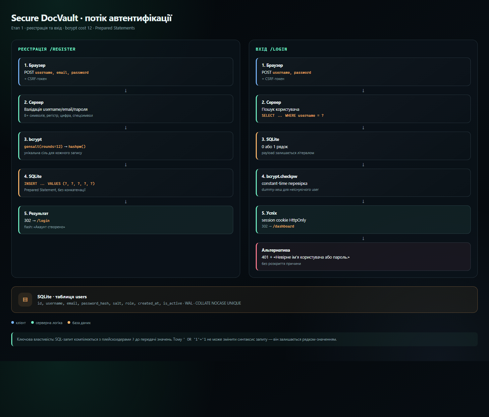
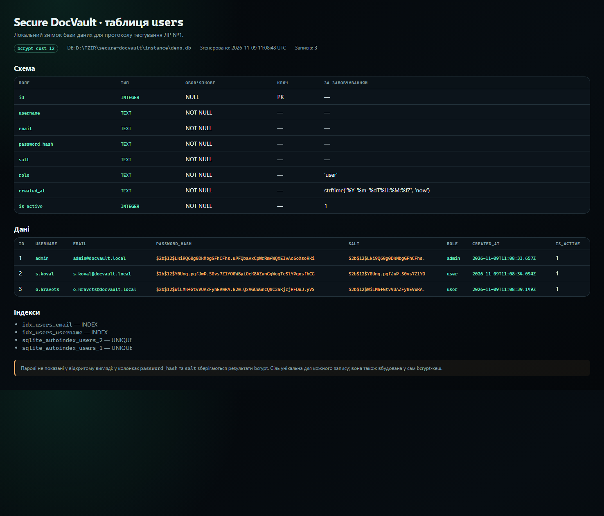
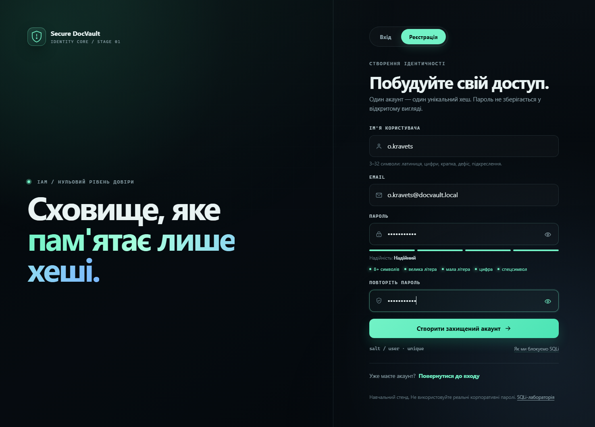
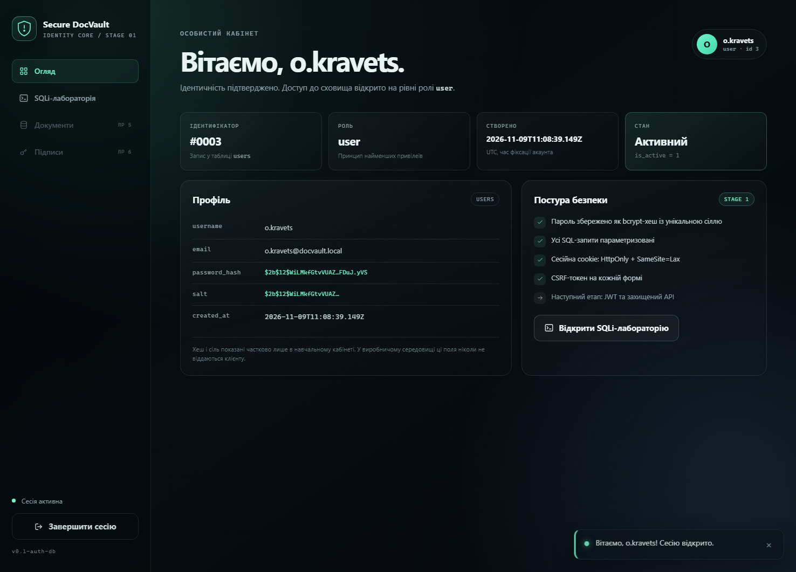
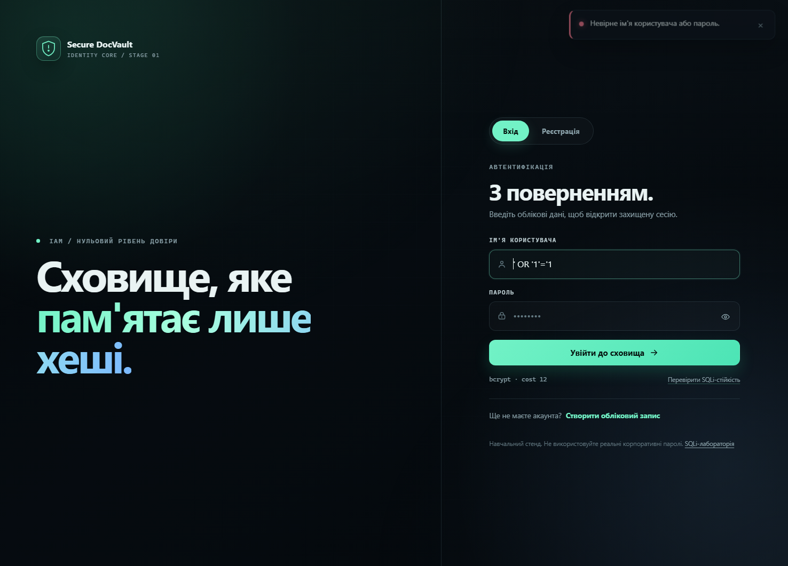
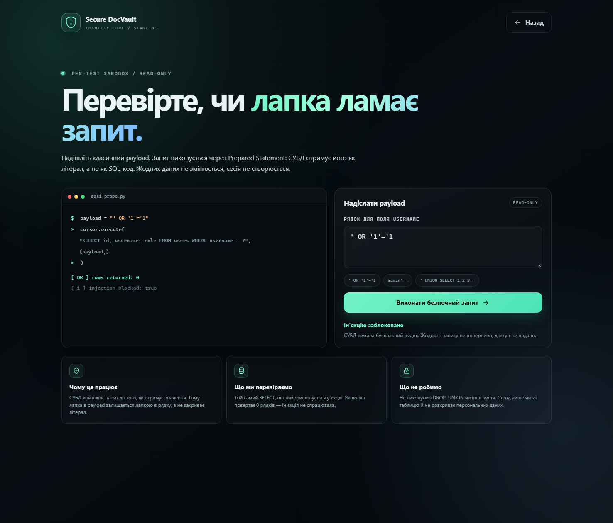

# ЗВІТ

## з лабораторної роботи №1

### «Фундамент безпеки: Автентифікація та захист бази даних»

**Наскрізний навчальний проєкт:** «Secure DocVault» (Етап 1)

---

**Заклад вищої освіти:** Дрогобицький державний педагогічний університет імені Івана Франка

**Факультет:** фізики, математики, економіки та інноваційних технологій

**Кафедра:** фізики та інформаційних систем

**Освітньо-професійна програма:** «Комп'ютерні науки»

**Рівень вищої освіти:** перший (бакалаврський)

**Дисципліна:** «Технології захисту інформаційних ресурсів»

**Тема:** Фундамент безпеки: Автентифікація та захист бази даних

**Номер роботи:** 1

**Виконав:** ______________________________

**Група:** ______________________________

**Викладач:** ______________________________

**Рік:** 2026

---

## 1. Мета та постановка задачі

**Мета роботи:** створити первинне безпечне ядро бекенду корпоративного порталу
Secure DocVault — підсистему безпечної реєстрації та входу користувачів із
підключенням реляційної бази даних, криптографічним хешуванням паролів із
застосуванням солі та апаратним захистом від SQL-ін'єкцій через параметризовані
запити.

**Завдання:**

1. Розгорнути структуру проєкту `secure-docvault`, віртуальне середовище Python
   та локальний Git-репозиторій.
2. Спроєктувати таблицю `users` з полями `id`, `username`, `email`,
   `password_hash`, `salt`, `role`, `created_at`, `is_active`.
3. Реалізувати хешування паролів bcrypt із work factor 12 та унікальною сіллю.
4. Реалізувати всі SQL-запити через Prepared Statements.
5. Реалізувати веб-інтерфейс реєстрації та входу з валідацією складності пароля.
6. Змоделювати SQL-ін'єкцію `' OR '1'='1` і довести її блокування.
7. Підготувати протокол тестування, скриншоти, Git-коміт і висновки.

**Місце етапу в архітектурі Secure DocVault.** Етап 1 закладає фундамент
системи управління ідентифікацією та доступом (IAM). На цьому рівні
формуються довірені облікові записи, безпечне зберігання паролів і базовий
модуль перевірки автентичності. Саме цей модуль у ЛР №2 буде використаний для
випуску JWT-токенів доступу. Без надійного захисту облікових даних усі вищі
рівні захисту втрачають сенс.

**Вибір інтерфейсу.** У методичному прикладі використано десктопний PyQt-клієнт.
У цій роботі реалізовано **веб-інтерфейс на Flask + Jinja2** з авторським темним
дизайном «Obsidian Vault». Це дає змогу продемонструвати ті самі механізми
безпеки в браузері, а також перевірити їх E2E-тестами через Selenium.

---

## 2. Архітектура та схема даних

### 2.1. Таблиця `users`

| Поле | Тип | Обмеження | Призначення |
|---|---|---|---|
| `id` | INTEGER | PRIMARY KEY AUTOINCREMENT | унікальний ідентифікатор |
| `username` | TEXT | NOT NULL, UNIQUE, COLLATE NOCASE | ім'я для входу |
| `email` | TEXT | NOT NULL, UNIQUE, COLLATE NOCASE | контактна адреса |
| `password_hash` | TEXT | NOT NULL | повний bcrypt-хеш `$2b$12$...` |
| `salt` | TEXT | NOT NULL | унікальна сіль (також вбудована в хеш) |
| `role` | TEXT | NOT NULL, DEFAULT `'user'`, CHECK | роль доступу |
| `created_at` | TEXT | NOT NULL, DEFAULT UTC | час створення |
| `is_active` | INTEGER | NOT NULL, DEFAULT 1, CHECK | ознака активності |

SQL-схема:

```sql
CREATE TABLE IF NOT EXISTS users (
    id            INTEGER PRIMARY KEY AUTOINCREMENT,
    username      TEXT    NOT NULL COLLATE NOCASE UNIQUE,
    email         TEXT    NOT NULL COLLATE NOCASE UNIQUE,
    password_hash TEXT    NOT NULL,
    salt          TEXT    NOT NULL,
    role          TEXT    NOT NULL DEFAULT 'user'
                          CHECK (role IN ('user', 'admin')),
    created_at    TEXT    NOT NULL DEFAULT (strftime('%Y-%m-%dT%H:%M:%fZ', 'now')),
    is_active     INTEGER NOT NULL DEFAULT 1
                          CHECK (is_active IN (0, 1))
);
```

### 2.2. Діаграма процесу реєстрації та входу



Ключова властивість: SQL-запит компілюється з плейсхолдерами `?` до передачі
значень. Тому payload `' OR '1'='1` не може змінити синтаксис запиту — він
залишається рядком-значенням.

---

## 3. Лістинг програмного коду

Повні файли знаходяться у репозиторії:

- `app/auth_security.py` — криптографія та валідація;
- `app/database.py` — схема та параметризовані запити;
- `app/auth.py` — маршрути, CSRF, сесії, SQLi-стенд.

### 3.1. `app/auth_security.py` (ключові фрагменти)

```python
def validate_password(password: str) -> list[str]:
    """Мінімум 8 символів, великі/малі літери, цифра, спецсимвол."""
    errors: list[str] = []
    password = password or ""

    if not password:
        errors.append("Пароль не може бути порожнім.")
        return errors
    if len(password) < 8:
        errors.append("Пароль має містити щонайменше 8 символів.")
    if len(password.encode("utf-8")) > BCRYPT_MAX_BYTES:
        errors.append("Пароль не може перевищувати 72 байти (обмеження bcrypt).")
    if not any(ch.isupper() for ch in password):
        errors.append("Додайте хоча б одну велику літеру.")
    if not any(ch.islower() for ch in password):
        errors.append("Додайте хоча б одну малу літеру.")
    if not any(ch.isdigit() for ch in password):
        errors.append("Додайте хоча б одну цифру.")
    if not any((not ch.isalnum()) and (not ch.isspace()) for ch in password):
        errors.append("Додайте хоча б один спеціальний символ (!@#$%^&* тощо).")
    return errors


def hash_password(password: str, rounds: int = 12) -> tuple[str, str]:
    """Хешує пароль і повертає пару (bcrypt-хеш, сіль)."""
    encoded = password.encode("utf-8")
    if len(encoded) > BCRYPT_MAX_BYTES:
        raise ValueError("Пароль перевищує 72 байти — bcrypt не може його обробити.")

    salt = bcrypt.gensalt(rounds=rounds)
    digest = bcrypt.hashpw(encoded, salt)
    return digest.decode("ascii"), salt.decode("ascii")


def verify_password(plain_password: str, password_hash: str) -> bool:
    """Constant-time перевірка через bcrypt.checkpw."""
    try:
        return bcrypt.checkpw(
            plain_password.encode("utf-8"),
            password_hash.encode("ascii"),
        )
    except (ValueError, TypeError):
        return False


@lru_cache(maxsize=4)
def _dummy_hash(rounds: int) -> bytes:
    """Службовий хеш для вирівнювання часу входу."""
    return bcrypt.hashpw(b"docvault-dummy-password", bcrypt.gensalt(rounds=rounds))


def verify_dummy(plain_password: str, rounds: int = 12) -> None:
    """Холостий bcrypt-розрахунок для неіснуючого користувача."""
    try:
        bcrypt.checkpw(plain_password.encode("utf-8"), _dummy_hash(rounds))
    except (ValueError, TypeError):
        pass
```

### 3.2. `app/database.py` (ключові фрагменти)

```python
def create_user(
    username: str,
    email: str,
    password_hash: str,
    salt: str,
    role: str = "user",
) -> int:
    """Додає користувача через параметризований INSERT."""
    db = get_db()
    cursor = db.execute(
        """
        INSERT INTO users (username, email, password_hash, salt, role)
        VALUES (?, ?, ?, ?, ?)
        """,
        (username, email, password_hash, salt, role),
    )
    db.commit()
    return int(cursor.lastrowid)


def find_user_by_username(username: str) -> sqlite3.Row | None:
    """Шукає користувача за іменем через Prepared Statement."""
    return get_db().execute(
        """
        SELECT id, username, email, password_hash, salt, role, created_at, is_active
        FROM users
        WHERE username = ?
        """,
        (username,),
    ).fetchone()
```

### 3.3. `app/auth.py` (фрагмент входу)

```python
user = find_user_by_username(username)
rounds = current_app.config["BCRYPT_ROUNDS"]

# Для неіснуючого користувача — dummy bcrypt-перевірка,
# щоб не розкривати факт існування акаунта за часом.
if user is None:
    verify_dummy(password, rounds=rounds)
    flash("Невірне ім'я користувача або пароль.", "error")
    return render_template("login.html", form=form), 401

if not user["is_active"]:
    verify_dummy(password, rounds=rounds)
    flash("Невірне ім'я користувача або пароль.", "error")
    return render_template("login.html", form=form), 401

if not verify_password(password, user["password_hash"]):
    flash("Невірне ім'я користувача або пароль.", "error")
    return render_template("login.html", form=form), 401

# Захист від session fixation: повністю оновлюємо сесію після входу.
session.clear()
session["user_id"] = user["id"]
session["_csrf_token"] = secrets.token_urlsafe(32)
session.permanent = True
```

---

## 4. Протокол тестування

### 4.1. Вміст таблиці `users` у БД

Скриншот згенеровано локально з демонстраційної БД. Видно, що паролі не
зберігаються у відкритому вигляді: у полі `password_hash` — bcrypt-рядок
`$2b$12$...`, у полі `salt` — унікальна сіль. Усі три солі різні.



### 4.2. Успішна реєстрація з валідацією складності пароля

Форма заповнена паролем `Vault#2026!`. Індикатор показує «Надійний», усі п'ять
правил підсвічені зеленим. Серверна валідація дублює клієнтську.



Після натискання «Створити захищений акаунт» користувача перенаправлено на
сторінку входу з повідомленням про успіх:


### 4.3. Успішний вхід

Після введення правильного пароля відкривається закритий кабінет. У профілі
показано ідентифікатор, роль, час створення, частково замаскований хеш і сіль.



### 4.4. Помилка входу з хибним паролем

Введено `Wrong#2026!` замість `Vault#2026!`. Сервер повертає єдине нейтральне
повідомлення «Невірне ім'я користувача або пароль.», не розкриваючи, що саме
неправильно.


### 4.5. Моделювання SQL-ін'єкції у формі входу

У поле «Ім'я користувача» введено класичний payload:

```text
' OR '1'='1
```

Пароль — довільний. Результат: доступ не надано, повернуто 401 і нейтральне
повідомлення. Це підтверджує, що payload не став частиною SQL-синтаксису.



### 4.6. SQLi-лабораторія: read-only перевірка

Стенд `/security-lab` виконує той самий параметризований `SELECT`, що й вхід,
але не створює сесію та не повертає персональних даних. Результат:
`rows returned: 0`, `injection blocked: true`.



### 4.7. Автоматичні тести

```text
python -m unittest tests.test_security tests.test_database -v
Ran 25 tests in 2.664s
OK

python -m unittest tests.test_web_e2e -v
Ran 9 tests in 19.077s
OK
```

Що перевірено:

- 17 юніт-тестів політики пароля, username/email, bcrypt-хешу, унікальності
  солей, коректної та хибної перевірки;
- 8 тестів схеми БД, унікальності, регістронезалежного пошуку та SQLi-payload;
- 9 E2E-тестів у реальному браузері: реєстрація, слабкий пароль, успішний вхід,
  хибний пароль, SQLi, CSRF, захист dashboard, показ пароля.

---

## 5. Git-коміт

Репозиторій ініціалізовано локально. Перший стабільний коміт позначено тегом
`v0.1-auth-db`.

```bash
git log --oneline --decorate
# <hash> (HEAD -> main, tag: v0.1-auth-db) feat: secure auth core and users database

git tag
# v0.1-auth-db
```

Для здачі викладачеві потрібно додати remote та виконати `git push --tags`.
Посилання на репозиторій: `______________________________`.

---

## 6. Висновки

1. **Повільні алгоритми хешування.** bcrypt із work factor 12 виконує
   `2^12` ітерацій, тому кожна спроба підбору є значно дорожчою, ніж для
   MD5/SHA-1/SHA-256. Це робить brute-force та rainbow-table атаки
   економічно недоцільними. Work factor можна збільшувати з часом, що дає
   можливість адаптуватися до зростання потужності GPU.
2. **Унікальна сіль.** Сіль унеможливлює використання заздалегідь
   обчислених таблиць: однакові паролі двох користувачів дають різні хеші.
   Сіль не є секретом, її можна зберігати поряд із хешем.
3. **Prepared Statements.** Параметризований запит компілюється з
   плейсхолдерами до передачі значень. СУБД сприймає payload як літерал,
   тому лапки, коментарі та `UNION` не змінюють синтаксис. Це принципово
   надійніше за ручну фільтрацію лапок, яку можна обійти.
4. **Додаткові рівні.** CSRF-токени, `session.clear()` після входу,
   `HttpOnly`/`SameSite` cookie, єдине повідомлення про помилку та dummy
   bcrypt-перевірка зменшують ризик CSRF, session fixation, user enumeration
   та timing-атак.
5. **Практичний результат.** Створено робочий веб-застосунок, який успішно
   проходить 34 автоматичні перевірки та демонструє блокування SQLi-payload
   `' OR '1'='1`.

---

## 7. Відповіді на контрольні питання

### 7.1. Чому MD5, SHA-1, SHA-256 вразливі для паролів? Що таке rainbow table?

Це швидкі хеш-функції загального призначення. Вони проєктувалися для
перевірки цілісності великих обсягів даних, а не для зберігання секретів.
Сучасні GPU обчислюють мільярди SHA-256-хешів за секунду, тому перебір
паролів стає швидким. Rainbow table — це заздалегідь обчислена таблиця
відповідностей «хеш → пароль». Якщо хеші не солені, атакуючий може миттєво
знайти пароль за таблицею. Сіль робить кожен хеш унікальним і руйнує
можливість повторного використання таблиці.

### 7.2. Призначення солі. Чому вона унікальна і чи потрібно її засекречувати?

Сіль — випадкове значення, яке додається до пароля перед хешуванням. Вона
гарантує, що однакові паролі дають різні хеші, і що rainbow table не можна
застосувати повторно. Сіль має бути унікальною для кожного користувача
(бажано — для кожного запису пароля). Сіль **не потрібно** зберігати в
секреті: вона зберігається поряд із хешем, але її унікальність і достатня
ентропія роблять атаку невигідною. Секретом є сам пароль, а не сіль.

### 7.3. Принцип work factor у bcrypt/Argon2. Чому важливо збільшувати складність?

Work factor — це параметр, який визначає кількість обчислювальної роботи для
одного хешування. У bcrypt `rounds=12` означає `2^12` ітерацій; у Argon2
аналогічно налаштовуються memory cost, time cost і parallelism. Збільшення
work factor лінійно/квадратично збільшує час для захисника, але експоненційно
збільшує вартість масового перебору для атакуючого. З часом обладнання
дешевшає, тому параметри треба періодично підвищувати; старі хеші можна
перехешувати під час наступного входу користувача.

### 7.4. Чому Prepared Statements гарантують захист від SQLi, а фільтрація лапок — ні?

Prepared Statement розділяє **код запиту** і **дані**. СУБД спочатку
компілює запит із плейсхолдерами `?`, а потім підставляє значення як
параметри. Тому значення ніколи не інтерпретується як SQL-синтаксис.
Фільтрація лапок — це чорний список: вона залежить від контексту, кодування,
драйвера та може бути обійдена через альтернативні представлення, коментарі,
`UNION`, числові контексти тощо. Параметризація — це структурний захист на
рівні протоколу СУБД, а не евристика.

### 7.5. Що таке timing attack і як `checkpw` захищає від витоку?

Timing attack — це атака за часом виконання. Якщо перевірка пароля
порівнює символи по одному і зупиняється на першій розбіжності, час
відповіді залежить від кількості правильних перших символів. Атакуючий може
підбирати пароль посимвольно. `bcrypt.checkpw` виконує порівняння у
постійному часі (constant-time) і не зупиняється на першій розбіжності, тому
час не розкриває, який префікс був правильним. Додатково dummy-хеш для
неіснуючого користувача вирівнює час між «користувач є» та «користувача
немає».

---

## Додаток. Відтворення результатів

```bash
# 1. Встановлення
python -m venv venv
venv\Scripts\activate          # Windows
pip install -r requirements-dev.txt

# 2. Запуск
copy .env.example .env         # Windows
python run.py

# 3. Тести
python -m unittest tests.test_security tests.test_database -v
python -m unittest tests.test_web_e2e -v

# 4. Скриншоти
python scripts/capture_screenshots.py

# 5. Демо-користувач
python scripts/seed_demo.py
```

**Демо-пароль:** `Vault#2026!` (створюється `scripts/seed_demo.py`).
